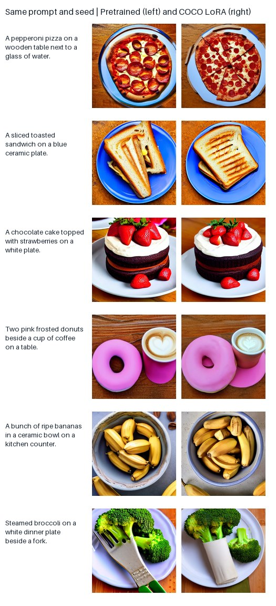

# COCO Food Diffusion

Can fine-tuning on a small set of captioned food photos improve a pretrained
text-to-image model? This Colab experiment adapts Stable Diffusion v1.5 with LoRA
and compares the two models on the same prompts and initial noise.

[Executed notebook](notebooks/coco_food_diffusion.ipynb) · [Open in Colab](https://colab.research.google.com/github/MedvAx-AI/coco-food-diffusion/blob/main/notebooks/coco_food_diffusion.ipynb)

## Experiment

- **Data.** 600 training photos with 2,232 human-written captions and 72 held-out
  photos from the official MS COCO 2017 splits. Six food categories contribute
  equally. Each selected image has an instance annotation and a caption naming
  its food.
- **Training.** 240 optimizer updates on a Colab T4 at 384 × 384, using 480
  distinct images from the training pool. Rank-8 LoRA
  trains 795,648 parameters in the U-Net's text cross-attention. The image and
  text encoders and the original U-Net weights stay frozen.
- **Evaluation.** Six authored prompts and three matched seeds per prompt.
  Both models use the same 24-step DDIM sampler and guidance scale. A separate
  set of 72 photos measures held-out denoising loss and checks the food classifier.

| Metric | Pretrained | COCO LoRA |
| --- | ---: | ---: |
| Held-out denoising MSE | 0.19753 | 0.19459 |
| Mean full-prompt CLIP cosine | 0.3260 | 0.3284 |
| Requested food ranked first | 17/18 | 18/18 |

The adapted model had a higher CLIP score on 8 of 18 pairs. The mean gain was
small, and both versions generated one donut in the gallery for a prompt asking
for two. The food-label probe ranked the annotated class first on 88.9% of the
held-out photos. It measures food identity and can miss counts and relationships.

## Reproduce

Open the notebook in Colab or download it from GitHub and upload it to Colab.
Choose a **T4 GPU** and select **Runtime → Run all**.
It downloads public COCO data and model weights, trains the adapter, and
generates the comparison and evaluation. The run saves the resulting adapter
as `/content/pmldl_coco/coco-food-lora.safetensors` in the Colab runtime.

The notebook originated as a PMLDL coursework experiment. Source material
includes [MS COCO](https://cocodataset.org/),
[Stable Diffusion v1.5](https://huggingface.co/stable-diffusion-v1-5/stable-diffusion-v1-5),
and [LoRA](https://arxiv.org/abs/2106.09685).
