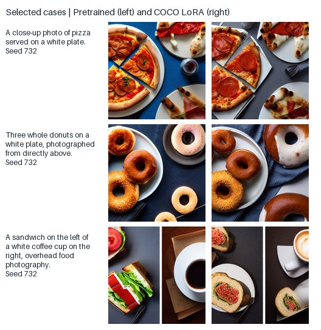

# COCO food prompt-following benchmark

[Prompt manifest](prompts.csv) · [Per-image detections](detections.json) ·
[Scores by threshold](scores.csv) · [Benchmark notebook](../notebooks/benchmark.ipynb)

Each of 27 prompts was sampled with seeds 732 and 984 for both models at
384 × 384 using 24 DDIM steps and guidance 7.5. Prompts cover food identity
(12), exact counts (9), and left/right placement relative to a cup (6).
No full prompt was an exact match for a training caption.

[DETR ResNet-50](https://huggingface.co/facebook/detr-resnet-50) supplied the
bounding boxes. Identity requires at least one detection of the named food.
Counting requires exactly the requested number of detections of that food.
Placement compares the horizontal centers of the highest-confidence food
and cup boxes. The correct order must differ by more than eight pixels.
A missing food or cup fails the placement check.

| Confidence | Food identity (24 pairs) | Exact count (18 pairs) | Left/right (12 pairs) |
| ---: | ---: | ---: | ---: |
| 0.30 | 21 → 22 | 3 → 5 | 4 → 3 |
| 0.50 | 21 → 22 | 3 → 5 | 4 → 3 |
| 0.70 | 21 → 21 | 4 → 5 | 4 → 3 |

Arrows show the pretrained score followed by the adapted score. On 72
held-out real photos, DETR found the annotated food in 68 photos at 0.30
and 0.50, and 65 at 0.70. That check measures class presence. Count and
layout scores have no human-reviewed reference labels for the full set.
The sample is small, and the data support a mixed result across tasks.

In the selected images the pizza is recognizable on both sides. Both models
draw extra donuts for the exact-three prompt. The tuned sandwich example has
multiple visible sandwich pieces, including one on the right, illustrating
the difference between the detector's single-box rule and the full scene.

**All 108 outputs** are visible in the contact sheets.
[Identity I](../assets/benchmark-identity-1.jpg) ·
[Identity II](../assets/benchmark-identity-2.jpg) ·
[Counts I](../assets/benchmark-count-1.jpg) ·
[Counts II](../assets/benchmark-count-2.jpg) ·
[Left/right](../assets/benchmark-spatial.jpg)

Run `python benchmark/score.py` from the repository root to regenerate
the score table from the saved detections with the Python standard library.

## Checkpoint provenance

The [adapter](../weights/coco-food-lora.safetensors) comes from a repeat
of the original 240-update Colab T4 recipe. The original notebook's earlier
checkpoint was temporary. The repeat reached held-out MSE 0.19459 from
0.19753. On the original 18-pair CLIP check, the repeat scored 0.3252
versus 0.3260 for the pretrained model. The larger benchmark uses the
packaged repeat's weights, generated images, and detections.

SHA-256 `8bad61aaa803fafb20446c6080b686f97a4a2500e447d70a56e24aa995aaa008`.
